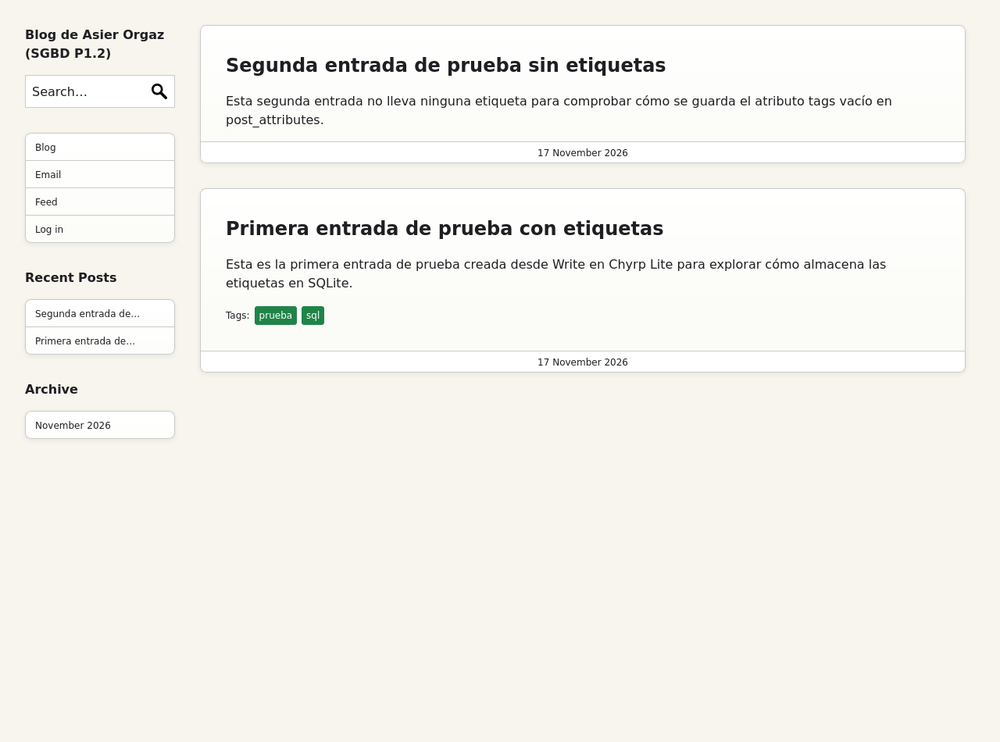
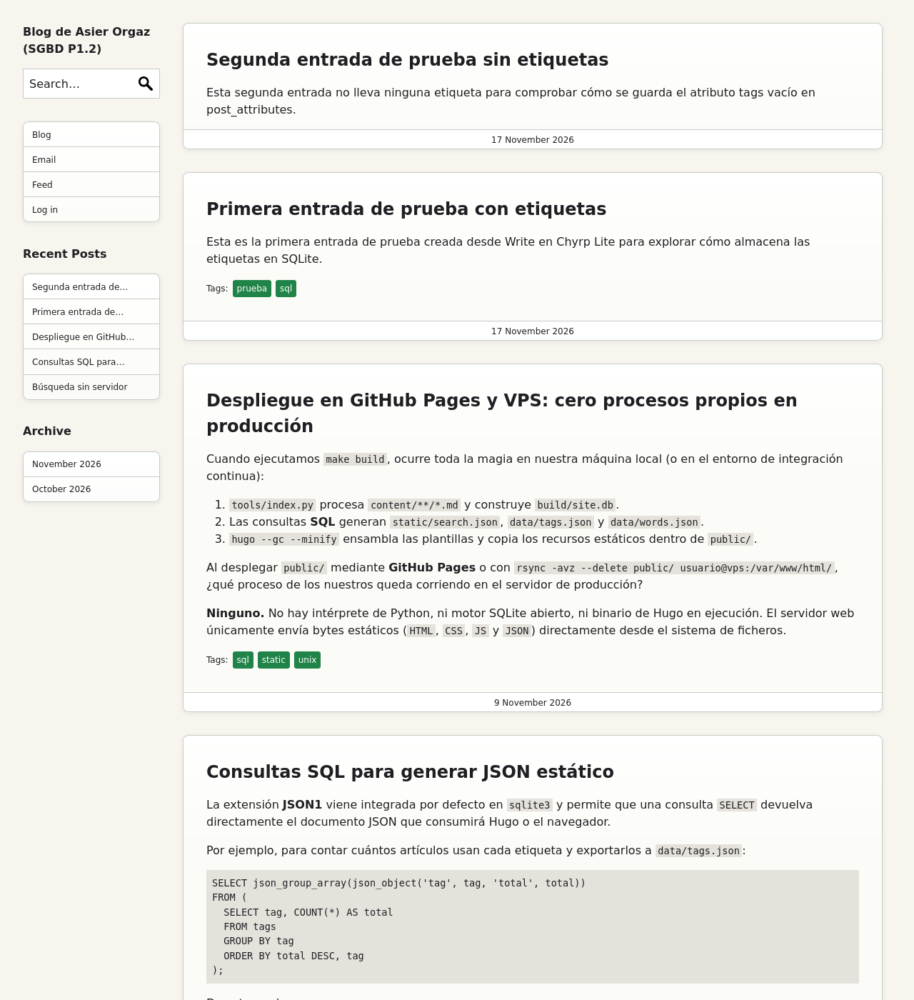
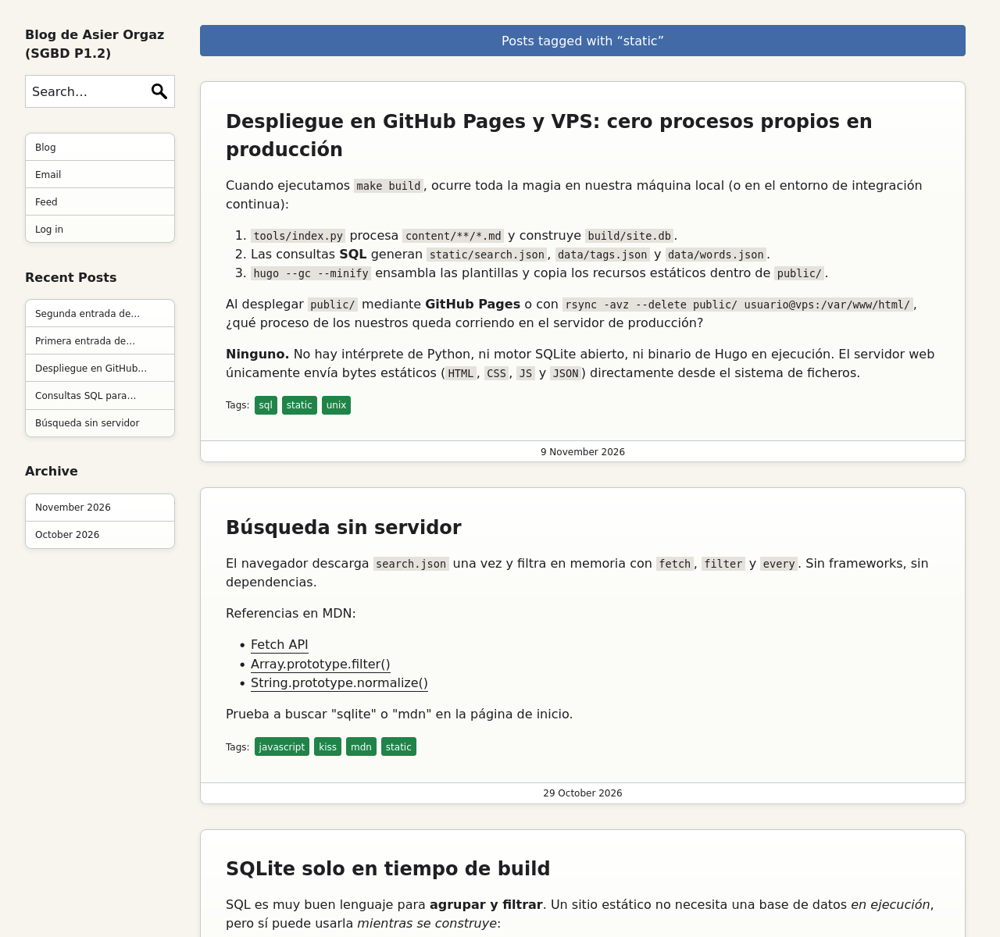
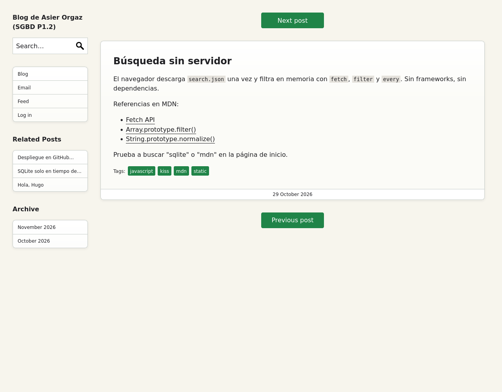
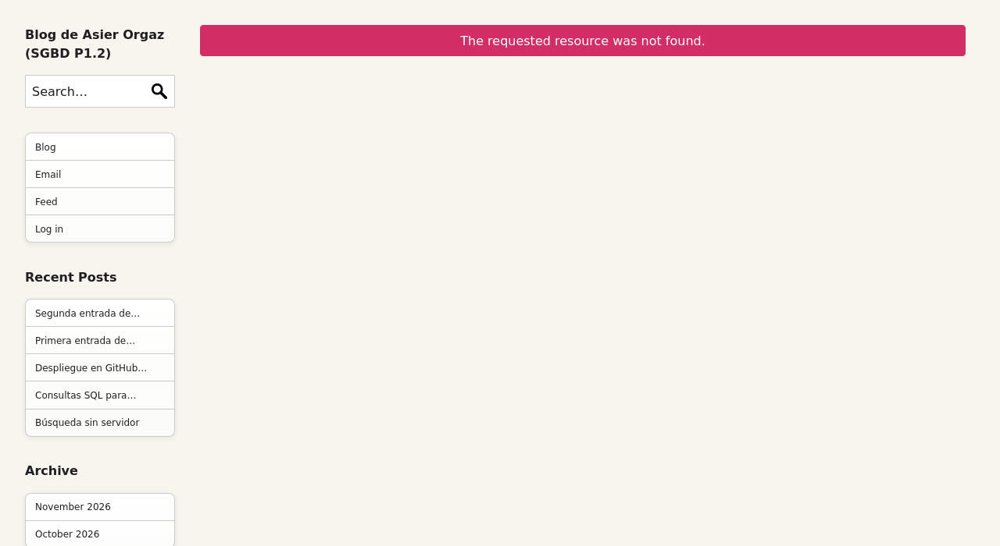
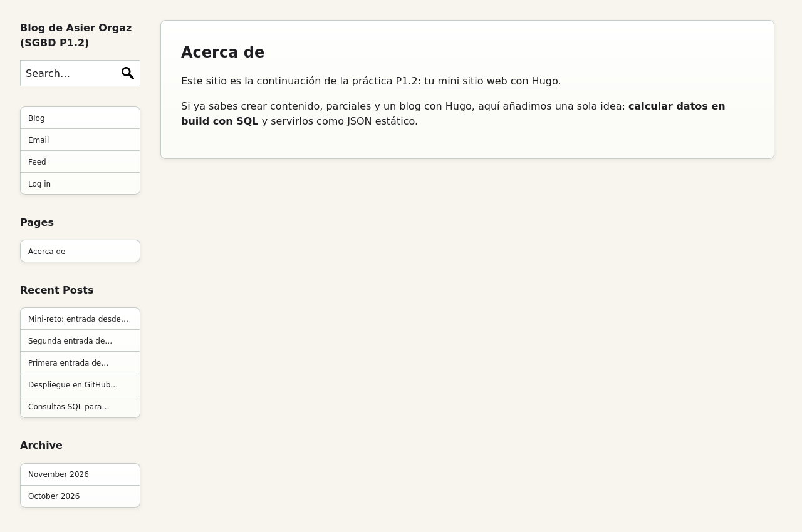
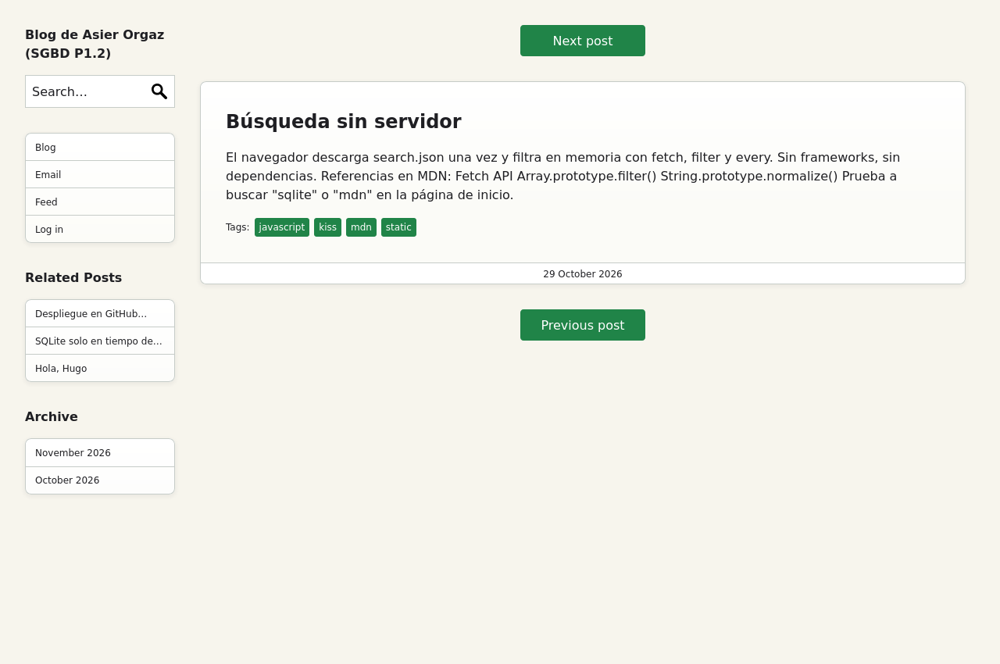
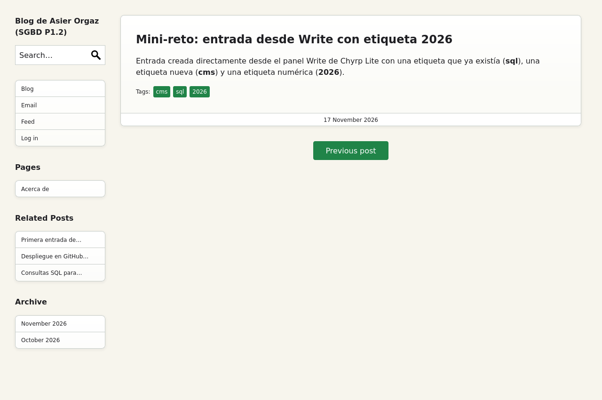

# Práctica P1.2 SGBD: de Hugo + SQLite a Chyrp Lite + SQLite

**Alumno:** Asier Orgaz Gabriel (2º ASIR)

## 1. Instalación de Chyrp Lite con SQLite

He instalado los paquetes necesarios en la máquina virtual Debian (`php-cli`, `php-sqlite3`, `php-mbstring`, `php-curl`, `php-xml`, `sqlite3`, `unzip`, `git`, `make` y `python3`) y he comprobado con `php -v` y `php -m` que estaban activos `PDO`, `pdo_sqlite` y `sqlite3`.

Después he descomprimido Chyrp Lite en `~/chyrp`, he borrado la carpeta `tools` y he guardado la base de datos fuera de la carpeta web, en `/home/asier/chyrp-datos/blog.sqlite`. Una vez instalado desde `http://192.168.5.169:8080/install.php`, he activado el módulo **Tagginator** en *Extend -> Modules* y desde *Write* he creado las dos entradas de prueba.

| Dato | Valor |
| :--- | :--- |
| Versión de PHP (`php -v`) | PHP 8.4.27 (cli) |
| Versión de Chyrp Lite | Chyrp Lite 2026.03.01 (Sichuan) |
| Ruta del fichero `.sqlite` | `/home/asier/chyrp-datos/blog.sqlite` |
| Captura de la portada con las entradas de prueba | `capturas/01_portada_entradas_prueba.png` |



## 2. Explorar el esquema de Chyrp Lite

Haciendo una copia en `/tmp/blog-copia.sqlite` y abriéndola con `sqlite3`:

```sql
sqlite> .tables
groups           permissions      posts            users          
pages            post_attributes  sessions       

sqlite> .schema posts
CREATE TABLE IF NOT EXISTS "posts" (
  id INTEGER PRIMARY KEY AUTOINCREMENT,
  feather VARCHAR(32) DEFAULT '',
  clean VARCHAR(128) DEFAULT '',
  url VARCHAR(128) DEFAULT '',
  pinned BOOLEAN DEFAULT FALSE,
  status VARCHAR(32) DEFAULT 'public',
  user_id INTEGER DEFAULT 0,
  created_at DATETIME DEFAULT NULL,
  updated_at DATETIME DEFAULT NULL
);

sqlite> .schema post_attributes
CREATE TABLE IF NOT EXISTS "post_attributes" (
  post_id INTEGER NOT NULL,
  name VARCHAR(100) DEFAULT '',
  value LONGTEXT,
  PRIMARY KEY (post_id, name)
);
```

Y consultando los datos de las dos entradas de prueba:

```text
sqlite> SELECT * FROM posts;
1|text|primera-entrada-de-prueba-con-etiquetas|primera-entrada-de-prueba-con-etiquetas|0|public|1|2026-11-17 17:07:26|1000-01-01 00:00:00
2|text|segunda-entrada-de-prueba-sin-etiquetas|segunda-entrada-de-prueba-sin-etiquetas|0|public|1|2026-11-17 17:07:27|1000-01-01 00:00:00

sqlite> SELECT * FROM post_attributes;
1|title|Primera entrada de prueba con etiquetas
1|body|Esta es la primera entrada de prueba creada desde Write en Chyrp Lite para explorar cómo almacena las etiquetas en SQLite.
1|tags|{"prueba":"prueba","sql":"sql"}
2|title|Segunda entrada de prueba sin etiquetas
2|body|Esta segunda entrada no lleva ninguna etiqueta para comprobar cómo se guarda el atributo tags vacío en post_attributes.
2|tags|[]
```

- **¿Qué tablas hay y para qué sirve cada una?**
  - `posts`: guarda los datos generales de cada entrada del blog (id, tipo de entrada o `feather`, slug `clean`, `url`, si está fijada `pinned`, estado `status`, autor `user_id` y fechas).
  - `post_attributes`: guarda los campos de contenido de cada post (`title`, `body`, `tags`...) como filas clave-valor asociadas a `post_id`.
  - `pages`: guarda las páginas estáticas del sitio (como un "Acerca de").
  - `users`: usuarios registrados del blog (login, contraseña hasheada, correo, grupo...).
  - `groups`: grupos de usuarios (Admin, Member, Guest...).
  - `permissions`: permisos que tiene asignados cada grupo.
  - `sessions`: sesiones de usuario activas.
- **¿Cuántas filas ocupa cada entrada en cada tabla? ¿Dónde está el título? ¿Y el cuerpo?**
  Cada una de mis dos entradas de prueba ocupa **1 fila en `posts`** y **3 filas en `post_attributes`**. Ni el título ni el cuerpo están en la tabla `posts`, sino en `post_attributes` (en la fila donde `name = 'title'` y en la fila donde `name = 'body'`).
- **¿Qué clave primaria tiene `post_attributes`? ¿Por qué es compuesta? ¿Qué clave foránea lleva?**
  Su clave primaria es `PRIMARY KEY (post_id, name)`. Es compuesta porque un mismo `post_id` tiene varios atributos distintos (`title`, `body`, `tags`), y el mismo nombre `name` se repite en todos los posts, pero la pareja `(post_id, name)` no se puede repetir. `post_id` hace de clave foránea apuntando a `posts(id)` (aunque en el `.schema` de SQLite no han puesto el `REFERENCES` explícito).
- **¿Existe una tabla de etiquetas? ¿Qué hay en `value` cuando `name` es `tags` y en la entrada sin etiquetas?**
  No existe tabla de etiquetas. En la primera entrada, `value` tiene un JSON con formato `{"nombre":"slug"}`, concretamente `{"prueba":"prueba","sql":"sql"}`. En la segunda entrada (la que no tiene etiquetas), también se crea la fila `tags`, pero en `value` guarda `[]`.
- **¿Cómo se guarda la fecha? ¿Qué valor tiene `updated_at` en una entrada que nunca se ha editado?**
  Se guarda en formato `YYYY-MM-DD HH:MM:SS` (por ejemplo `2026-11-17 17:07:26`). Cuando una entrada nunca se ha editado, `updated_at` vale `1000-01-01 00:00:00`.
- **¿Qué diferencia hay entre `clean` y `url` de `posts`? ¿Qué valores puede tomar `status`?**
  `clean` es el slug limpio sacado del título, mientras que `url` es el identificador único final que se usa en la dirección del post (por si hubiera dos entradas con el mismo `clean`, que no choquen). `status` toma `'public'` o `'draft'` (y también permite privadas, programadas o por grupo).
- **Ventaja e inconveniente del diseño EAV (`post_attributes`):**
  La ventaja es que si activas módulos nuevos (como el de etiquetas) o distintos tipos de post (fotos, citas, enlaces), pueden guardar campos nuevos metiendo filas en `post_attributes` sin tener que hacer `ALTER TABLE` en `posts`. El inconveniente es que para consultar hay que hacer más `JOIN` o subconsultas, y como todo va en `value` (`LONGTEXT`) se pierden los tipos de datos de SQL.

## 3. Correspondencia entre esquemas

Al ejecutar `make index` y mirar `.schema` en `build/site.db` del prototipo de Hugo:

- **¿Cuál es la clave primaria de `posts`? ¿Y de `tags`?**
  En `posts` la clave primaria es `url` (`TEXT PRIMARY KEY`). En `tags` es compuesta: `PRIMARY KEY (url, tag)`, donde `url` referencia a `posts(url)`.
- **¿Qué tipo de relación hay entre entradas y etiquetas?**
  Una entrada puede tener varias etiquetas y una etiqueta estar en varias entradas (`N:M`), aunque en el prototipo no hay una tabla maestra de etiquetas con id propio: la etiqueta es directamente un texto en `tags(url, tag)`.
- **¿Qué contiene `posts.body`: el Markdown original o texto plano?**
  Contiene texto plano sin formato, porque `plain()` en `tools/index.py` le quita las marcas de Markdown (enlaces, código, asteriscos, títulos...) antes de hacer el `INSERT`.
- **¿Qué pasa con las entradas en borrador (`draft: true`)? ¿Aparecen en `build/site.db`?**
  No aparecen por defecto, porque `read_all()` filtra los ficheros que tienen `draft: true`.

### Tabla de correspondencia

| Prototipo (P1.1) | -> | Chyrp Lite (`tabla.columna` o atributo) | Transformación necesaria |
| :--- | :---: | :--- | :--- |
| título (`title`) | -> | `post_attributes` (`name = 'title'`, `value`) | Insertar fila en `post_attributes` con el `post_id` de la entrada. |
| cuerpo (el Markdown de cada `.md`) | -> | `post_attributes` (`name = 'body'`, `value`) | Leerlo directamente del fichero `.md` (quitando el front matter) para no perder el formato Markdown. |
| fecha (`date`) | -> | `posts.created_at` | Pasar de `YYYY-MM-DD` a `YYYY-MM-DD HH:MM:SS` (añadiendo `00:00:00` si no lleva hora). |
| nombre del fichero (`hola-hugo.md`) | -> | `posts.clean` y `posts.url` | Quitar la extensión `.md` y pasarlo a minúsculas sin tildes ni caracteres raros (`slugify`). |
| `description` / `summary` | -> | No tiene equivalente | Se pierde (el tipo `text` de Chyrp Lite solo tiene título y cuerpo). |
| etiquetas (`tags`) | -> | `post_attributes` (`name = 'tags'`, `value`) | Pasar la lista `['a', 'b']` a un JSON `{"a":"a","b":"b"}`, o `[]` si no tiene etiquetas. |
| `draft: true` | -> | `posts.status` | Si `draft` es `true` poner `'draft'`, y si no, `'public'`. |
| autor | -> | `posts.user_id` | Buscar el `id` en la tabla `users` (por defecto el primer usuario, `1`). |
| columnas sin origen (`feather`, `pinned`, `updated_at`) | -> | `posts.feather`, `posts.pinned`, `posts.updated_at` | Valores fijos: `feather = 'text'`, `pinned = 0`, `updated_at = '1000-01-01 00:00:00'`. |

## 4. Lectura guiada (`tools/migrar.py`)

1. **¿Qué funciones tocan el disco o SQL y cuáles no? ¿Por qué `test_migrar.py` puede probar `transformar` sin base de datos?**
   No tocan ni disco ni SQL: `slugify`, `fecha_chyrp`, `etiquetas_json` y `transformar` (son funciones puras). Tocan disco `leer_entrada` y `extraer` (leen los `.md`), y tocan SQL `comprobar_destino`, `buscar_autor`, `existe`, `insertar` y `cargar`. `test_migrar.py` puede probar `transformar` sin base de datos porque solo recibe un diccionario en memoria, el `user_id` y la fecha, y devuelve otro diccionario sin hacer consultas ni leer ficheros.
2. **¿Dónde empieza y termina la transacción? ¿Qué pasaría con las filas ya insertadas si falla el `INSERT` de la 3.ª entrada?**
   Empieza al entrar en el bloque `with con:` dentro de `cargar` y termina al salir de ese bloque. Si falla el `INSERT` de la 3.ª entrada, el `with con:` hace un `rollback` automático de toda la transacción, así que las 2 primeras entradas que ya se habían insertado se deshacen y la base de datos se queda como estaba antes de empezar.
3. **¿Qué columna usa el script para saber que una entrada ya está migrada? ¿Es una buena elección? ¿Qué pasaría con dos ficheros con el mismo nombre en carpetas distintas?**
   Usa la columna `url` de la tabla `posts` en la función `existe(con, url)`. Para un blog sencillo está bien porque la URL identifica al post, pero como `leer_entrada` saca el slug solo de `path.stem` (el nombre del archivo sin la carpeta), si hubiera dos archivos llamados igual en carpetas distintas, el segundo daría la misma `url` y `existe()` lo saltaría como `omitida`.
4. **¿Por qué `etiquetas_json` devuelve `[]` y no `{}` cuando no hay etiquetas?**
   Porque en PHP un array vacío `array()` sirve tanto para listas como para diccionarios, y cuando PHP hace `json_encode(array())` devuelve `"[]"` en vez de `"{}"`. Como vimos en la segunda entrada de prueba sin etiquetas, Chyrp Lite guarda `[]`.
5. **¿Por qué `updated_at` vale `1000-01-01 00:00:00`? ¿De dónde sale ese valor?**
   Es el valor `SQL_DATETIME_ZERO` que usa internamente Chyrp Lite cuando se crea una entrada nueva para indicar que todavía no ha sido modificada nunca.
6. **¿Por qué se usa `cur.lastrowid` entre los dos `INSERT`?**
   Porque el `id` de la tabla `posts` es `AUTOINCREMENT` y lo genera SQLite al insertar la fila en `posts`. Necesitamos recuperar ese `id` con `cur.lastrowid` para ponérselo como `post_id` a las 3 filas que se insertan justo después en `post_attributes`.
7. **Comparación de `transformar` con mi tabla de la Parte 3:**
   Coincide prácticamente en todo: manda `title`, `body` y `tags` al diccionario `attrs` (que va a `post_attributes`) y el resto de campos fijos y calculados a `post` (que va a `posts`), dejando fuera `description`/`summary`.

## 5. Ejecución y verificación de la migración

Al ejecutar en la VM los pasos de la Parte 5 sobre `~/chyrp-datos/copia.sqlite`:

```text
$ make test
python3 -m unittest discover -s tools -v
...
Ran 11 tests in 0.001s
OK

$ make migrar DESTINO=$HOME/chyrp-datos/copia.sqlite SIMULACRO=1
simulada  borrador
simulada  busqueda-sin-servidor
simulada  consultas-agregadas-sql
simulada  despliegue-estatico-github-pages
simulada  hola-hugo
simulada  sqlite-en-build-time
migrar: 6 entradas leídas, 6 nuevas, 0 ya estaban

$ make migrar DESTINO=$HOME/chyrp-datos/copia.sqlite
creada    borrador
creada    busqueda-sin-servidor
creada    consultas-agregadas-sql
creada    despliegue-estatico-github-pages
creada    hola-hugo
creada    sqlite-en-build-time
migrar: 6 entradas leídas, 6 nuevas, 0 ya estaban

$ make migrar DESTINO=$HOME/chyrp-datos/copia.sqlite
omitida   borrador
omitida   busqueda-sin-servidor
omitida   consultas-agregadas-sql
omitida   despliegue-estatico-github-pages
omitida   hola-hugo
omitida   sqlite-en-build-time
migrar: 6 entradas leídas, 0 nuevas, 6 ya estaban
```

### Comprobación con SQL (Parte 6)

```text
sqlite> SELECT COUNT(*) FROM posts;
8

sqlite> SELECT p.id, p.clean, p.status, a.value AS titulo
   ...> FROM posts p
   ...> JOIN post_attributes a ON a.post_id = p.id AND a.name = 'title'
   ...> ORDER BY p.id;
1|primera-entrada-de-prueba-con-etiquetas|public|Primera entrada de prueba con etiquetas
2|segunda-entrada-de-prueba-sin-etiquetas|public|Segunda entrada de prueba sin etiquetas
3|borrador|draft|Esto es un borrador
4|busqueda-sin-servidor|public|Búsqueda sin servidor
5|consultas-agregadas-sql|public|Consultas SQL para generar JSON estático
6|despliegue-estatico-github-pages|public|Despliegue en GitHub Pages y VPS: cero procesos propios en producción
7|hola-hugo|public|Hola, Hugo
8|sqlite-en-build-time|public|SQLite solo en tiempo de build

sqlite> SELECT COUNT(*) FROM post_attributes WHERE name = 'tags' AND value LIKE '%:"static"%';
4
```

En `data/tags.json` del prototipo la etiqueta `static` tenía `"total": 4`, que coincide con las 4 entradas que devuelve la consulta en Chyrp Lite.

### Capturas de la verificación en el navegador

**Portada con las entradas migradas (se ven las públicas con su formato y fechas originales, sin el borrador):**


**Página de la etiqueta `static` (`/?action=tag&name=static`) con las 4 entradas:**


**Entrada individual con enlaces, lista, código y su fecha original (`29 October 2026`):**


**Intento de abrir el borrador (`/?action=view&url=borrador`) como visitante (da 404):**


## 6. Ejercicios resueltos

### Ejercicio 1: Rompe la transacción a propósito
- **Qué cambié:** En `insertar()` añadí una condición para lanzar `raise RuntimeError("fallo")` al llegar a la tercera entrada nueva, y probé sobre una copia limpia de la base de datos (que tenía las 2 entradas de prueba iniciales). Luego repetí la prueba quitando el `with con:` (en modo autocommit).
- **Qué esperaba y cómo lo comprobé:**
  - Con `with con:`, al fallar en la 3.ª entrada saltó el `RuntimeError` y al hacer `SELECT COUNT(*) FROM posts;` seguía habiendo **2 entradas** (hizo rollback de las que llevaba insertadas).
  - Quitando la transacción, el script también falló en la 3.ª entrada, pero al hacer `SELECT COUNT(*) FROM posts;` habían quedado **5 entradas** en la tabla (las 2 iniciales más las que le dio tiempo a insertar antes del fallo). Con esto queda claro por qué hace falta meter toda la carga en una sola transacción.

### Ejercicio 2: Migra las páginas (`content/about.md` -> `pages`)
- **Qué cambié:** Miré `.schema pages` y vi que la tabla `pages` no usa `post_attributes`, sino que tiene directamente las columnas `title`, `body`, `public`, `show_in_list`, `list_order`, `clean`, `url`, `user_id`, `parent_id`, `created_at` y `updated_at`. Añadí en `tools/migrar.py` la función pura `transformar_pagina()`, `extraer_paginas()`, `cargar_paginas()` y el flag `--paginas`, además de su test en `tools/test_migrar.py`.
- **Cómo lo comprobé:** Ejecuté `python3 tools/migrar.py --destino ~/chyrp-datos/blog.sqlite --paginas`, comprobé con `SELECT * FROM pages;` que se había creado la fila `about` y abrí `/?action=page&url=about` en el navegador:



### Ejercicio 3: Compara con la variante desde `build/site.db`
- **Qué cambié:** Añadí la función `extraer_desde_db()` y la opción `--desde-db` en `tools/migrar.py` para leer las filas de las tablas `posts` y `tags` de `build/site.db` en vez de los ficheros `.md`.
- **Cómo lo comprobé y qué se pierde:** Migré sobre una copia limpia con `python3 tools/migrar.py --desde-db build/site.db --destino /tmp/copia-desde-db.sqlite` y la probé en el navegador. Se pierden dos cosas:
  1. **El formato Markdown del cuerpo:** como en `build/site.db` el campo `body` pasa por `plain()`, en el blog se ve todo el texto seguido en un único párrafo, sin enlaces, ni listas, ni bloques de código.
  2. **El borrador (`borrador.md`):** solo se migran 5 entradas en vez de 6 porque `build/site.db` no guarda los borradores.



### Ejercicio 5: Descubre un límite (etiqueta `2026`)
- **Qué cambié:** Creé desde *Write* una entrada con la etiqueta numérica `2026` y miré en `post_attributes` qué había guardado Chyrp Lite:
  `{"\ufe0e2026":"a3a10ebe2ba87b81b32702fce0637e74"}`
  No coincidía con lo que daba `etiquetas_json(["2026"])` (`{"2026":"2026"}`). Mirando `modules/tags/tags.php`, vi que cuando la etiqueta es un número Chyrp Lite le añade delante el carácter `\ufe0e` para que PHP no convierta la clave del array en un entero, y como el slug solo tiene números usa su hash MD5 como slug. Añadí la función `par_etiqueta()` en `tools/migrar.py` y el test `test_etiqueta_numerica_2026` en `tools/test_migrar.py`.
- **Cómo lo comprobé:** Ejecutando `make test` (`Ran 13 tests ... OK`).

## 7. Mini-reto: crea una entrada nueva y mírala en la BD

Desde *Write* he publicado una entrada nueva con la etiqueta `sql` (que ya existía), una nueva (`cms`) y `2026`. Al mirar en SQLite:

```text
sqlite> SELECT * FROM posts WHERE id = 9;
9|text|mini-reto-write-2026|mini-reto-write-2026|0|public|1|2026-11-17 17:15:08|1000-01-01 00:00:00

sqlite> SELECT post_id, name, value FROM post_attributes WHERE post_id = 9;
9|body|Entrada creada directamente desde el panel Write de Chyrp Lite con una etiqueta que ya existía (**sql**), una etiqueta nueva (**cms**) y una etiqueta numérica (**2026**).
9|tags|{"sql":"sql","cms":"cms","\ufe0e2026":"a3a10ebe2ba87b81b32702fce0637e74"}
9|title|Mini-reto: entrada desde Write con etiqueta 2026
```

- **Filas creadas:** Ha creado 1 fila en `posts` y 3 filas en `post_attributes` (`title`, `body` y `tags`), porque en el modelo EAV cada atributo del post va en su propia fila. Con la etiqueta nueva (`cms`) no se crea ninguna fila en otra tabla, solo se mete dentro del JSON de `tags` de esa entrada.
- **Consulta por etiqueta:** En Chyrp Lite hay que buscar dentro del texto serializado con `LIKE`:
  `SELECT post_id FROM post_attributes WHERE name = 'tags' AND value LIKE '%:"sql"%';`
  Mientras que en el prototipo era un `JOIN` normal sobre la columna `tag` (`SELECT * FROM posts JOIN tags USING(url) WHERE tag = 'sql'`).



## 8. Preguntas para reflexionar

1. **En el prototipo de la P1.1, ¿qué pasaba si SQLite fallaba en producción? ¿Y ahora en Chyrp Lite? ¿Qué ha cambiado en la disponibilidad del sitio?**
   En la P1.1 SQLite no estaba en producción, solo se usaba al hacer el build para generar los JSON y el HTML estático, así que en el servidor web no podía fallar SQLite. En cambio, en Chyrp Lite PHP consulta el fichero `.sqlite` en cada visita: si SQLite falla o el fichero se borra o se bloquea, la web entera deja de funcionar.
2. **SQLite es un fichero y no un servidor. Si 50 personas visitaran el blog a la vez, ¿qué problema podría aparecer? ¿Cuándo tendría sentido pasar a MySQL o PostgreSQL?**
   SQLite lleva bien muchas lecturas a la vez, pero cuando alguien escribe bloquea el fichero entero (`database is locked`). Si 50 personas entran a la vez y la aplicación guarda sesiones, visitas o comentarios en la BD, se pueden producir bloqueos por escrituras simultáneas. Tendría sentido pasar a MySQL o PostgreSQL cuando haya bastantes escrituras concurrentes (varios usuarios publicando o comentando a la vez) o mucho tráfico.
3. **Hacer una copia de seguridad de este blog ¿qué fichero(s) exige copiar? Compáralo con el blog estático de la P1.1.**
   En Chyrp Lite es obligatorio hacer copia de seguridad del fichero `/home/asier/chyrp-datos/blog.sqlite` (y de la carpeta `uploads/` y `includes/config.json.php`), porque ahí están guardadas todas las entradas y si se pierde no se puede regenerar. En la P1.1 `build/site.db` daba igual borrarla porque todo salía de los ficheros `.md` del repositorio.
4. **Normalización: tu tabla `tags(url, tag)` está en forma normal. Las etiquetas de Chyrp Lite incumplen la primera forma normal. ¿Qué consultas se vuelven más difíciles? ¿Qué gana Chyrp Lite a cambio?**
   Al meter todas las etiquetas juntas en un JSON dentro de una sola columna, incumple la 1FN. Eso hace mucho más difícil contar cuántas entradas tiene cada etiqueta con un `GROUP BY`, sacar la lista de todas las etiquetas sin duplicados en SQL o renombrar una etiqueta en todos los posts. A cambio, Chyrp Lite gana simplicidad: el núcleo no necesita tablas extra para etiquetas y el módulo Tagginator puede guardar sus datos en `post_attributes` como cualquier otro atributo más.
5. **Escribir directamente en las tablas de otra aplicación se salta su lógica (validaciones, caché, módulos). ¿Qué riesgos tiene? ¿Qué alternativa habría si Chyrp Lite ofreciera una API o un importador?**
   El riesgo es meter datos que no cumplan lo que espera la aplicación (como nos pasó en el Ejercicio 5 con la etiqueta numérica `2026`, o meter dos posts con la misma `url` sin comprobar colisiones) o que no se actualicen las cachés. Si Chyrp Lite tuviera una API o un importador propio, llamaríamos a sus funciones de crear entradas para que sea el propio Chyrp Lite quien valide y guarde los datos.
6. **¿Por qué el módulo Migration de Chyrp Lite no te servía para esta práctica? ¿Qué tendría que traer para poder importar un sitio Hugo?**
   Porque el módulo Migration solo trae importadores para archivos XML/exportaciones de WordPress, Tumblr, TextPattern y MovableType. Para importar un sitio Hugo tendría que saber leer una carpeta de ficheros `.md`, separar el front matter YAML (`---`), sacar `title`, `date`, `draft` y `tags`, y meter el resto del fichero como cuerpo.
